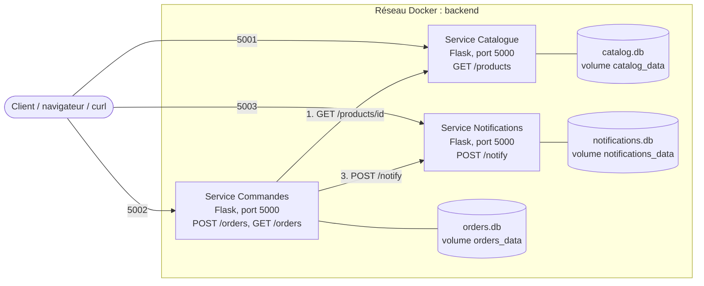

# TP Docker : Architecture microservices

## 1. Schéma de l'architecture



Ports exposés sur la machine : 5001 (Catalogue), 5002 (Commandes), 5003 (Notifications).
Dans le réseau Docker, chaque service écoute sur le port 5000 et est joint par son nom DNS (`catalog`, `orders`, `notifications`).

## 2. Description des services

### Service Catalogue
- Rôle : gérer les produits (nom, prix, stock).
- API : `GET /products`, `GET /products/{id}`, `POST /products`, `GET /health`.
- Données : SQLite dans le volume `catalog_data` (3 produits d'exemple au premier démarrage).
- Appelé par : le service Commandes.

### Service Commandes
- Rôle : créer et consulter les commandes.
- API : `POST /orders`, `GET /orders`, `GET /orders/{id}`, `GET /health`.
- Fonctionnement de `POST /orders` : 1) vérifie le produit et son prix auprès du Catalogue, 2) enregistre la commande dans sa propre base, 3) demande l'envoi d'une notification.
- Données : SQLite dans le volume `orders_data`.
- Résilience : erreur 503 si le Catalogue est indisponible ; la commande reste valide si les Notifications sont indisponibles (`"notified": false`).

### Service Notifications
- Rôle : enregistrer et « envoyer » les notifications (simulées par un log et une base).
- API : `POST /notify`, `GET /notifications`, `GET /health`.
- Données : SQLite dans le volume `notifications_data`.

## 3. Justification des choix techniques

| Choix | Justification |
|---|---|
| Flask (Python) | Léger, rapide à écrire, adapté aux petites API REST. |
| Un Dockerfile par service | Build, déploiement et mise à l'échelle indépendants. |
| `python:3.12-slim` | Image petite : build rapide et surface d'attaque réduite. |
| Une base par service (SQLite + volume) | Principe « database per service » : pas de couplage par la base, données persistantes. SQLite suffit pour un TP et ne demande aucun serveur ; en production, on utiliserait PostgreSQL. |
| REST/JSON via HTTP | Simple, standard et testable avec curl. |
| Réseau `backend` | Les services se joignent par leur nom ; isolation du reste de la machine. |
| Variables d'environnement | Les URL des services ne sont pas codées en dur. |
| Docker Compose | Un seul fichier et une seule commande pour tout lancer. |
| `restart: unless-stopped` | Redémarrage automatique en cas de plantage. |
| Notification non bloquante | Une panne des Notifications ne bloque pas les commandes. |

## 4. Lancement

```bash
docker compose up -d --build
docker compose ps
docker compose down        # arrêt (données conservées)
docker compose down -v     # arrêt + suppression des données
```
